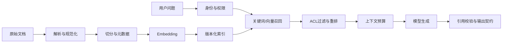

> **阅读说明**：本文以主站公开的 Agri-QA 农业问答项目档案和 AI Lab 架构记录作为学习案例。项目档案列出的技术栈包括 Python、FastAPI、LangGraph、ChromaDB、SQLite 与 Next.js；目前这些材料没有提供可复核的生产 SLA、并发量、准确率测试集或成本账单，因此本文不把项目简介当作源码审计或生产验证。因此，文中的指标定义是评估方案，代码段是教学用设计草图，改造前后对照是目标设计，不代表这些优化已经在项目中上线或取得了量化收益。

AI 应用工程的难点，很少只是“怎样调用一个模型”。真正的系统要在输入不完整、检索无结果、模型超时、工具参数异常、用户中途离开、权限发生变化和模型输出格式漂移时，仍然给出可解释、可恢复的行为。工程质量来自边界、状态、失败策略和证据，而不是提示词写得多长。

本文按一条真实请求的生命周期展开：先澄清需求与验收口径，再设计分层架构；随后讨论 Prompt、RAG、Agent、输出校验和 SSE 的协作边界；最后给出故障分析、评测闭环、前后方案对照、实习生学习路线，以及一份可以复制到新项目中的专业 Prompt。

## 1. 从产品问题定义系统边界

以农业知识问答为例，用户可能问：“叶片出现褐色斑点，我应该喷什么药？”这句话同时包含症状识别、知识检索、潜在安全风险和可能的用药建议。若系统只把字符串拼进 Prompt 并要求模型“给出准确答案”，应用就把关键产品决策外包给了生成模型。

更好的起点是把用户目标改写成可验收的行为：

1. 对领域内问题，仅使用当前用户有权限访问的资料作为证据。
2. 回答给出可追溯的来源片段；证据不足时明确说明不确定或转人工复核。
3. 不因为模型语气自信就把未经证实的建议包装成事实。
4. 输出结构可以被前端稳定渲染，也能被日志、评测和后续版本读取。
5. 用户取消请求后，应用尽可能取消上游生成和不再需要的工作。

这些行为是验收约束，不等同于“模型准确率提升”。把目标写成测试样例、状态转换和安全边界，才能知道程序该做什么，以及出现偏差时从哪一层排查。

### 先列非目标

本案例不声称可以自动诊断作物疾病，也不把原型的架构图等同于经过验证的生产系统。若产品需要实际农事建议，应由领域专家确定知识来源、风险等级、免责声明和人工升级规则。工程师负责把这些规则做成可执行的权限、路由和校验，而不是自行发明领域结论。

## 2. 全链路架构：每一层都要有输入、输出和失败行为

一个可维护的 AI 应用可以按职责拆为以下路径：

```text
Browser / Mobile
    │ HTTPS / SSE
    ▼
API Boundary ── Authentication / Authorization / Rate Limit
    │ validated request + request_id
    ▼
Application Use Case
    ├── Intent / Policy Router
    ├── Retrieval Port ── ACL Filter ── Vector / Keyword Index
    ├── Model Port ── Provider Adapter
    └── Tool Port ── Allowlist / Approval / Idempotency
    │ typed result + evidence + status
    ▼
Output Validation ── Persistence / Audit / Trace
    │ SSE events or JSON response
    ▼
Client rendering and user feedback
```

这里的层次不是为了把文件夹做得漂亮。它们把变化隔离开：模型供应商切换不应改写领域规则；换向量数据库不应影响 API 返回结构；前端流式展示不应决定数据库事务；工具的副作用也不应由模型直接执行。

| 边界 | 建议输入 | 建议输出 | 必须说明的失败行为 |
| --- | --- | --- | --- |
| API Boundary | 经身份验证的请求、租户与主体 | 已校验的命令、`request_id` | 401/403、请求体非法、限流拒绝 |
| Application Use Case | 命令、依赖接口 | 类型化业务结果 | 领域拒答、依赖超时、可恢复状态 |
| Retrieval Port | 查询、权限范围、索引版本 | 排序后的证据与元数据 | 无证据、索引不可用、权限摘要失效 |
| Model Port | 版本化消息、超时预算 | 原始响应或流事件 | 429/5xx、超时、拒答、取消 |
| Tool Port | 已验证的工具名与参数 | 结果、幂等标识 | 越权、重复执行、审批等待、外部失败 |
| Output Validation | 不可信模型文本/对象 | 通过 schema 的业务对象 | 格式非法、字段越界、拒答格式 |

**实习生训练重点**：给每个箭头写出 Python 类型或 JSON Schema，并回答“谁创建、谁释放、超时由谁负责、用户取消时谁收到取消”。答不出来的箭头通常是尚未设计好的隐式耦合。

## 3. Prompt Engineering：把自然语言要求变成版本化契约

Prompt 可以包含角色（role）、任务（task）、上下文（context）、证据（evidence）、输出契约（output contract）和拒答规则（refusal policy）。但 Prompt 不是权限系统、数据库约束或程序控制流。模型读到“不要访问其他租户数据”，并不能代替查询层对 `tenant_id` 的过滤。

可维护的 Prompt 至少要满足以下要求：

- **变量契约明确**：区分用户输入、检索片段、语言、产品版本和政策版本；禁止将任意变量无审查地拼接成系统规则。
- **上下文有来源**：每段检索证据保留 `document_id`、`chunk_id`、版本和权限元数据，生成后才有可能关联引用。
- **结构稳定**：声明字段、枚举、必填项、最大长度和拒答状态，随后在程序中再次校验。
- **版本可追踪**：记录 Prompt 版本或内容哈希、模型与参数版本、检索器与索引版本；否则线上答案无法复盘。
- **可评测**：同一组输入能在版本间回归；Prompt 改动要有预期差异与反例，而不是只凭一次对话判断好坏。
- **处理注入**：把文档和用户输入标记为不可信数据；指令层不能因检索文本内出现“忽略以上要求”而改变授权边界。

### 输出契约示意

这是教学用 schema 草图，具体 Pydantic 与模型 SDK 写法需要按项目固定的依赖版本调整：

```python
from typing import Literal
from pydantic import BaseModel, Field

class Citation(BaseModel):
    # Application-generated stable identity; never trust a model-invented ID.
    evidence_id: str  # e.g. "manual:crop-care:v3:chunk:0042"
    document_id: str
    document_version: str
    chunk_id: str
    quote: str = Field(min_length=1, max_length=800)

class Answer(BaseModel):
    status: Literal["answered", "needs_review", "insufficient_evidence"]
    answer: str = Field(max_length=4000)
    citations: list[Citation]
    next_step: str | None = None
```

结构化输出（structured output）减少了前端猜测自由文本的需要，但不自动保证语义正确：`citations` 字段通过 schema，只能说明形状正确；应用仍需核验引用 ID 属于本次检索、引用片段确实存在且用户有权访问。`evidence_id` 应由应用根据文档 ID、文档版本和 chunk ID 组成稳定标识；模型只能从本次检索候选中选择，不能自行编造。对外展示的引文也应从已校验的原始片段生成，避免模型改写后被误当作原文。

## 4. RAG：把“像是相关”变成可检查的证据链

检索增强生成（Retrieval-Augmented Generation, RAG）至少包括离线摄入和在线问答两条链。



### 离线摄入阶段

1. **解析与规范化**：提取正文、表格与必要结构，记录解析器版本；OCR 错误要能追溯到来源文件。
2. **切分（chunking）**：依据章节、标题、段落或语义边界切片。固定 token 数不是所有资料的最佳策略；表格、政策条款和代码片段需要保留结构关系。
3. **元数据（metadata）**：至少考虑来源、租户、权限标签、生效日期、语言、文档版本与删除状态。
4. **Embedding**：固定模型名称、版本、维度和归一化约定。换 Embedding 模型时应生成新索引版本，而不是混放不可比向量。
5. **发布索引**：建议构建 candidate index，完成校验后再切换 active pointer；发布失败时保留上一个可读版本。

### 在线检索阶段

检索顺序建议遵循安全优先：认证与授权 → 基于主体和租户限定候选数据 → 关键词/向量召回 → 合并候选 → 可选重排 → 去重和上下文预算 → 生成。不能先召回所有租户的数据，再在 Prompt 中要求模型忽略未授权片段。

当语料词汇精确、关键词重要时，BM25 可能有用；当表达方式多样时，向量召回能补充语义相似结果；混合检索能结合两种信号；reranker 提升排序质量的同时增加计算与延迟。没有固定语料、标注集和延迟预算时，不能仅凭“听起来更先进”决定生产架构。

缓存键也必须表达安全上下文。建议至少覆盖租户、权限摘要、索引版本、查询规范化版本及查询哈希：

```python
cache_key = (
    tenant_id,
    permission_digest,
    active_index_version,
    query_normalization_version,
    normalized_query_hash,
)
```

漏掉权限或索引版本，可能让用户在权限变更、文档删除或索引发布后读到旧结果。这不是“命中率调优”问题，而是数据隔离和一致性问题。

### 证据归属与拒答

模型生成后，应按证据 ID 校验引用，确认引用在检索候选中、当前仍有效且在当前主体的授权范围内。证据不足时返回 `insufficient_evidence` 或 `needs_review`，不要通过提高 Temperature 或加入“尽量准确”来填补证据缺口。

可参考已有的 [RAG 证据链记录](/ai-lab/research/retrieval-evidence/) 与 [混合检索评测计划](/ai-lab/experiments/retrieval-evaluation-plan/) 做进一步练习。

## 5. Agent 与 Tool Calling：模型提出动作，应用掌握执行权

Agent（智能体）不是“会思考的服务端”。一个可控的工具调用循环是：模型给出工具候选 → 应用校验工具名与参数 → 授权与风险判断 → 执行 → 规范化工具结果 → 将结果交回模型或结束工作流。

模型输出的函数调用是**不可信提议**，不是授权令牌。工具执行必须在应用层做 allowlist、schema 校验、主体授权、资源级权限检查、超时和审计。

| 操作风险 | 示例 | 保护措施 |
| --- | --- | --- |
| 只读 | 查询某个公开作物知识条目 | 数据权限过滤、速率限制、结果脱敏 |
| 低风险写入 | 保存用户草稿或偏好 | CSRF/主体校验、幂等键、可撤销记录 |
| 高风险副作用 | 创建订单、发送通知、修改关键配置 | 明确授权、二次确认或人工审批、审计和补偿流程 |

重试可能造成重复副作用。为写操作设计 `idempotency_key`；对付款、通知、删除等动作，明确重放、补偿、超时后状态不明和人工处理路径。除非业务语义允许，不要把“工具调用失败就再跑一次”当作通用恢复策略。

## 6. Async、SSE 与取消：用户断开也是一条业务状态

Server-Sent Events（SSE）通过单向 HTTP 流把服务端事件送到客户端，适合逐步展示生成进展。它不等同于 WebSocket；客户端断开、代理缓冲、网络重连和服务端生成之间的生命周期要由应用明确管理。

事件协议可以采用如下教学示意：

```text
id: req-7:12
event: token
data: {"delta":"检索到两条可访问的来源。"}

id: req-7:13
event: done
data: {"status":"answered","citation_count":2}
```

至少区分 `token`、`status`、`error`、`done` 等事件；错误事件不得泄漏 API key、内部 Prompt、完整堆栈或未授权资料。响应应声明 `Content-Type: text/event-stream`，并按部署环境设置 `Cache-Control: no-cache`；若经过 Nginx，可针对该流关闭代理缓冲（例如 `X-Accel-Buffering: no`），同时检查 CDN 与压缩中间件是否仍在聚合数据。长时间无 token 时可发 SSE 注释心跳（如 `: keep-alive\n\n`），它不是业务事件。一个响应必须恰好以 `done` 或 `error` 中的一种终止，终止后不得继续发送事件。若支持重连，评估 `id` 与 `Last-Event-ID` 语义；不要假设浏览器断开后可以无限期从内存继续恢复。

异步流式控制的伪代码如下，**重点是生命周期契约，不是可以直接复制的某个 SDK 代码**：

```python
async def stream_answer(request, provider, command):
    upstream = await provider.open_stream(command)
    try:
        async for event in upstream:
            if await request.is_disconnected():
                break
            yield encode_sse(event)
    finally:
        await upstream.aclose()
```

真实实现还要核对所用 SDK 的取消语义，并保证 `aclose()`、生成器 `finally`、HTTP response、Semaphore 和上游请求都能被释放。若同步模型 SDK 在 `async def` 中直接执行，它可能阻塞事件循环；优先使用真正的异步客户端，确实只能用同步库时，再按框架建议放进受限线程池。

**背压（backpressure）**：若消费者速度跟不上生产者，应限制队列或使用流控策略，不能无限缓存 token。**超时预算**应拆成连接、检索、模型首 token、总响应等阶段；重试要共享总预算，不可每层都各自重试三次而造成放大。

## 7. 开发中容易碰到的坑：症状 → 根因 → 修复 → 防回归

以下是 AI 应用开发中常见的故障模式。具体 SDK 方法名与框架版本需按项目依赖验证，本文不宣称 Agri-QA 原型已遇到或修复了所有问题。

### 坑一：模型“答得很好”，却引用了错误或越权的资料

- **症状**：答案语气流畅，但引用不存在、文档已删除，或来自其他租户。
- **根因**：只验证自然语言输出，没有把来源 ID、权限范围和索引版本作为程序状态；或把权限约束只写在 Prompt 中。
- **修复**：在检索查询前执行 ACL 限制；模型返回 evidence IDs；应用回查本次授权检索集合及文档版本。无证据时返回明确状态。
- **防回归**：加入“相似内容但权限不同”“删除后不可见”“过期版本不可引”等对抗样例，断言未授权 evidence ID 永不进入上下文。

### 坑二：流式页面关掉了，模型仍继续生成并消耗资源

- **症状**：客户端请求已经结束，连接池或后台任务还在工作。
- **根因**：HTTP response 生命周期结束，不等于上游 SDK 任务自动取消；生成器退出时资源没有 `finally` 清理。
- **修复**：建立 request-scoped cancellation；客户端断开时停止迭代并向上游传播取消；统一释放响应、信号量和临时资源。
- **防回归**：用可控制的 fake provider 生成长流；中途断开测试客户端；验证生成任务完成取消、资源释放且不会再发事件。

### 坑三：模型输出 JSON，偶尔却无法解析

- **症状**：多了 Markdown 围栏、字段缺失、枚举拼错、拒答格式不同。
- **根因**：把“Prompt 要求返回 JSON”当作机器契约。
- **修复**：使用支持的结构化输出能力或显式 parser，并在应用层做 Pydantic/JSON Schema 校验；对拒答、截断和字段版本演进设置不同处理。
- **防回归**：对格式错误、字段越界、空数组、拒答、旧 schema 和供应商错误响应做单元及集成测试；记录 schema 版本。

### 坑四：加了重试，偶发故障反而更严重

- **症状**：遇到 429 或依赖变慢时，重试流量再把下游压垮；写操作重复执行。
- **根因**：没有区分瞬态错误与永久错误；重试无上限或没有幂等性，也没有整个请求的 deadline。
- **修复**：针对可重试的瞬态错误用指数退避和 jitter，尊重 Retry-After；只在操作幂等、剩余预算足够时重试。校验失败、未授权、无证据通常不通过重试解决。
- **防回归**：注入 429、超时、5xx 和重复响应，检查重试次数、deadline、幂等键与并发上限。

### 坑五：换了向量模型，旧索引和缓存仍被继续读取

- **症状**：召回质量出现难以解释的波动，更新或删除文档后仍看到旧片段。
- **根因**：embedding 维度/版本、chunker 或语料快照变化，却没有建立新索引命名空间；缓存键没包含索引版本。
- **修复**：给语料、解析器、chunker、embedding 和索引分配版本；新索引影子构建与校验后原子切换；缓存以 active index version 隔离。
- **防回归**：固定一组文档变更、删除、重建与回滚测试，比较 active pointer 与查询结果。

### 坑六：对话越长，费用和结果越难控制

- **症状**：把全部历史塞进每次请求，token 增长、早期错误事实被反复引用，清除会话后仍能在摘要中找到隐私。
- **根因**：把短期消息历史、长期记忆、工具执行状态和用户档案混为一体。
- **修复**：分别定义各状态的所有者、TTL、容量、删除方式和是否参与推理；摘要必须保留来源或明确不确定性；每轮按 token 预算裁剪上下文。
- **防回归**：检查最大上下文、删除后不可恢复、跨用户隔离和摘要漂移；不记录不必要的原始敏感输入。

### 坑七：Demo 通过人工点测，却无法定位线上质量回退

- **症状**：用户报告答案错误，团队无法还原当时用的 Prompt、索引或模型版本。
- **根因**：日志只有自由文本，没有关联 ID、版本和阶段耗时；或者为调试记录了过多敏感内容。
- **修复**：用 `request_id/trace_id` 串接 API、检索、模型、工具与输出验证；记录 Prompt/索引/模型版本、阶段耗时、状态、token 与错误类别；默认脱敏或不保存原文。
- **防回归**：写自动化 trace schema 测试，确认每次调用可定位、字段有界、敏感值已脱敏。

## 8. 优化前后对照：写清变化，不编造收益数字

| 维度 | 优化前常见草图 | 建议目标设计 | 怎么证明真的改善 |
| --- | --- | --- | --- |
| API 职责 | 路由函数内直接拼 Prompt、查库、调用模型 | Router 处理 HTTP；Use Case 编排；Adapter 隔离模型与向量库 | 单测可以注入 fake；依赖替换不改领域规则 |
| RAG 权限 | 检索后告诉模型“忽略无关信息” | 检索前做主体/租户过滤，生成后复核 evidence IDs | 越权样例召回数应为 0；权限回归集版本化 |
| 输出格式 | 返回任意字符串，让前端解析 | typed response + schema validation + 显式拒答状态 | malformed/拒答/旧 schema 回归通过 |
| 流式取消 | 浏览器关闭后只停止前端渲染 | request disconnect 向 provider 传播，统一 cleanup | fake stream 断开后任务与资源被释放 |
| 稳定性 | 每层都做独立重试 | 共享 deadline、重试预算、幂等规则、限流 | 故障注入下重试次数和队列有上限 |
| RAG 发布 | 直接覆盖索引 | candidate build → 验证 → 原子切换 → 可回滚 | 固定数据集可重现版本切换与回滚 |
| 质量评估 | “这个回答看起来不错” | golden set、指标定义、人工复核和 trace | 记录评测版本与错误分布，不只看平均分 |
| 成本与隐私 | 保存全部 Prompt/响应以便调试 | 最小化留存、脱敏、token/阶段成本与访问审计 | 检查访问策略、字段脱敏与删除流程 |

这里的“优化前后”是工程设计对照，不是 Agri-QA 性能基准。没有固定数据集、环境和代码版本时，不能宣称延迟下降了某个百分比，也不能把设计改动自动等同于效果提升。

### 如何设计可复核的 RAG 评测

固定语料版本、切分器、Embedding 模型和查询集后，可以从以下指标开始：

- **Recall@K**：`|相关文档 ∩ Top-K| / |相关文档|`，衡量相关资料是否被找回。
- **MRR**：每个查询第一个相关结果排名倒数的平均值，强调首个有效结果的位置。
- **nDCG@K**：考虑相关等级与位置的折损排序质量。
- **Citation Support Rate**：先由标注者把回答拆成可核验事实断言。分子是至少被一个正确来源直接支持的断言数，分母是本次评测中所有应由证据支持的事实断言数；输出“无证据/拒答”且没有事实断言的样本不进入该比例分母，应另报拒答正确率与覆盖率。标注规程需约定“部分支持”“过期来源”“仅主题相关但不蕴含结论”如何计分，并由第二位标注者复核争议样例。
- **Recall@K**：仅对标注集中存在至少一个相关文档的查询计算 `|相关文档 ∩ Top-K| / |相关文档|`；没有相关文档的查询单独用于检验无证据识别和拒答，不能让零分母样例混入平均值。
- **权限违规率**：检索/回答中出现未经主体授权内容的测试样例比例；理想安全目标不是通过平均值稀释个别违规。
- **P50/P95 延迟**：分别观察典型与尾部体验，并按检索、首 token、完整回答拆分。
- **单位任务成本**：记录输入/输出 token、重试、Embedding、重排和外部工具成本；统一币种、价格时点和请求口径。

任何一项都不能单独代表“AI 质量”。数据集、标注、版本、拒答策略和人工复核都要随报告一起保存。当前 AI Lab 已有 [混合检索评测计划](/ai-lab/experiments/retrieval-evaluation-plan/)，该记录状态是待执行，不包含已测分数。

## 9. 可观测性：让答案可以回放，但不要把隐私写进日志

建议每个请求至少关联：

```text
request_id / trace_id
tenant_id 的非敏感标识或不可逆摘要
prompt_version / model_id / provider_region
corpus_version / chunker_version / embedding_version / index_version
retrieval candidate IDs、过滤原因、最终 evidence IDs
tool name、授权决策、idempotency key 摘要、执行状态
阶段耗时、token 数、重试次数、SSE disconnect/cancel 状态
schema_version、answer status、citation validation status
```

不要默认保存完整系统 Prompt、用户原始私密问题、API 密钥、工具凭据或未授权原文。追踪数据本身也是一种敏感数据：明确谁能读、保留多久、怎样脱敏、如何删除和如何应对用户数据访问请求。

## 10. 安全与可靠性检查

- **Prompt Injection**：将检索文档视为数据，不让其中的指令重写角色或权限；检查间接注入样本。
- **身份与租户隔离**：从认证上下文取得主体，不信任模型生成的 `tenant_id`。
- **工具白名单**：模型不能任意调用网络、文件系统或数据库；高风险动作做二次授权和审批。
- **输出安全**：HTML、SQL、shell、URL 等下游解释环境必须按目标上下文编码和验证。
- **密钥管理**：只在服务端保管 Provider key；前端混淆或加密后的静态密钥仍可被用户提取，不能当作机密存储。
- **资源上限**：限制输入长度、文件大小、并发、队列、工具步骤、模型 token、总预算和响应时间。
- **供应商故障**：区分降级、重试、备用模型与拒答；切换模型不应绕过输出和权限验证。
- **审计**：对可写工具和关键配置操作保存谁、何时、对什么对象、以什么授权执行。

## 11. 面向 AI 应用开发实习生的两周实战路线

目标不是两周“学会所有 AI”，而是交付一个可以解释、测试和演示的最小闭环。

| 时间 | 学习任务 | 可验收产物 |
| --- | --- | --- |
| 第 1–2 天 | Python typing、Pydantic、HTTP、异步边界 | 请求/响应/错误模型；输入校验测试 |
| 第 3 天 | FastAPI 路由、依赖注入、配置与 fake provider | 无真实密钥也能通过的应用层单测 |
| 第 4–5 天 | Prompt 模板、结构化输出、超时和拒答 | Prompt 版本、schema、非法响应测试 |
| 第 6–7 天 | 文档解析、chunk 元数据、向量/关键词召回 | 可复现的数据快照与检索结果记录 |
| 第 8 天 | 权限过滤、引用校验和无证据状态 | 两个租户隔离与引用归属回归样例 |
| 第 9 天 | 工具 schema、allowlist、幂等性 | 一个只读工具和一个被拒绝的越权用例 |
| 第 10 天 | SSE、首 token、取消和 cleanup | 手动取消与 fake stream 自动化测试 |
| 第 11–12 天 | golden set、检索指标、trace schema | 一份标注方法、指标脚本和失败样例 |
| 第 13 天 | 故障注入：429、timeout、空召回、坏 JSON | 有限重试、超时和降级的验证记录 |
| 第 14 天 | README、架构图、设计取舍和演示复盘 | 可从干净环境复现的交付说明与学习复盘 |

每个阶段都要让 Git commit 讲清楚“为什么改、怎么验证”。不必一次引入 LangChain、LangGraph、队列、向量库和多个 Agent；当标准库与一个简单 Use Case 就足够时，先保留简单实现。框架选择应解决状态编排、工具生命周期或可观测问题，而不是作为简历关键字。

## 12. 用费曼式学习法把概念变成工程能力


*插图：Pablo Stanley / Open Doodles · CC0 1.0。*

可以围绕每个模块重复四轮：

1. **选择一个窄概念**：例如“为什么 RAG 权限过滤必须发生在模型生成之前”，而不是一次复述整个 AI 架构。
2. **不用黑话解释给新人**：拿“图书管理员先检查借阅权限，再把能看的书放到桌上”解释 ACL 与上下文边界。
3. **找到卡壳处并回到证据**：如果无法解释缓存键为什么包含 index version，就查看代码、查询路径和失效条件；不要用“框架会处理”填空。
4. **重新组织并教回去**：画输入、状态、输出、失败路径；用一个测试证明解释不是只靠比喻。

再加一轮**主动回忆（active recall）**：合上材料回答“模型工具调用失败后会不会重试？什么情况下能重试？怎样避免副作用重复？”随后用间隔复习巩固。费曼式复述不能替代测试，但能暴露自己依赖的隐式假设。

### 本文核心概念的费曼练习

- 用三句话向非技术同学解释 RAG 的检索与生成分别做什么，以及为什么“检索到”不等于“证据支持”。
- 画出浏览器关闭 SSE 页面后，从 FastAPI 到 Provider 资源释放的取消链。
- 给工具调用画一个“模型只提议、应用授权后执行”的信任边界，并写一个越权测试。
- 用一个最小 JSON schema 解释“结构正确”与“语义正确”的区别。
- 对 Recall@K 手算一个小型 5 文档例子，再说明它为什么无法单独证明回答可靠。

## 13. 复盘：从“能返回结果”到“知道何时不该返回结果”

AI 工程最有价值的成长，不是把更多模型塞进流程，而是把可变的不确定性变成有限、可审计的状态：输入有 schema，调用有 deadline，检索有权限范围，回答有证据 ID，工具有授权和幂等，流式有取消，评测有固定数据，日志有脱敏规则。

这个主题的内容整合也带来几个具体工程教训：

1. **内容导入要保留主题上下文**：主站 `blog` 的正文可共享，但 AI Lab 文章需要自己的 `lab_category`，否则主题路由与分栏搜索无法正确工作。
2. **路由不能只改标题**：复制文章后，要同步更新文章间链接、旧手记的 `source_page`、中英文配对和首页关联入口，避免点击后跳回其他主题。
3. **封面资源遵循目标主题管线**：主站 Page Bundle 的 `featured.png` 不等同于 AI Lab 模板能通过 `resources.Get` 读取的全局 asset；迁入时要明确资源路径、替代文本和生成格式。
4. **主题校验器是契约**：文章 front matter 的栏目值必须属于 `data/ai_lab.yaml` 已声明的分类，日期和状态也要通过 Hugo 构建检查。
5. **文章工程能力要交证据**：提供失败用例、类型契约和复现步骤，比堆一串技术名词更能说明开发能力。

以上是内容迁移和设计流程的可观察约束；不等同于宣称主题已拥有生产级模型 SLA。真正的交付还需要构建通过、链接可达、封面可读、中文英文对应和页面交互检查。

## 14. 可复用的专业级开发 Prompt

把下面模板用于 AI 应用功能开发、技术文章撰写或项目复盘时，先补齐方括号里的项目事实。它要求模型区分证据与建议，避免把教学代码、架构图或估算数字写成已上线成果。

```text
你是一名资深 AI 应用架构师、Python/FastAPI 工程师、RAG 与 Agent 评审者、SRE/安全审查员，同时也是擅长带教实习生的技术导师。

任务：围绕【真实项目/功能名称】撰写一篇适合发布在【博客主题/栏目】中的完整 AI 应用工程技术文章。读者是具备【已知基础】的 AI 应用开发实习生。文章目标是让读者能解释系统、复现关键步骤、验证失败处理，并清楚知道哪些结论尚未被数据证明。

项目输入（只能依此陈述项目事实）：
- 产品目标与用户场景：【填入】
- 仓库/提交/代码路径：【填入可核查来源】
- 已实现的流程、接口和数据模型：【逐项填写】
- 技术栈及版本：【填写】
- 可复现实验、测试、运行环境与原始结果：【填写；无则明确写“未提供”】
- 已知限制、未实现项、隐私与安全约束：【填写】
- 目标读者已掌握/尚未掌握的知识：【填写】

事实与推断规则：
1. 将叙述分成“已核实事实”“建议架构/教学示例”“待验证假设”。只有代码、测试、运行日志或可引用资料支持时，才写成项目已经实现。
2. 不得虚构准确率、Recall、延迟、吞吐、用户数、成本节省、线上部署、代码细节或事故。没有数据时，给出需要收集的指标、数据集、对照方法与复现步骤。
3. 对第三方 SDK、框架 API、协议和模型能力标明版本或核对要求；不确定时明确标注并给出验证方法。
4. 不泄露密钥、个人信息或敏感 Prompt；说明日志脱敏、权限边界和数据保留。
5. 不把“Prompt 指示模型遵守”当作授权控制、输入校验或安全保证。

写作交付必须包括：
- 有具体场景、目标、非目标、前置条件与验收标准的引言。
- 从请求入口到数据库/模型/工具/返回结果的分层架构图，解释每个边界的输入、输出、状态所有者、失败责任人。
- 专业术语表：首次出现时给中英文全称、定义、在本场景的作用和容易混淆之处；至少覆盖【按题目选择：RAG/Embedding/Hybrid Search/Reranker/Agent/Tool Calling/Structured Output/SSE/Backpressure/Timeout/Retry/Idempotency/Trace/Recall@K/MRR 等】。
- 端到端数据流与关键代码：代码应类型清晰、可测试，并标注“可运行实现”或“教学伪代码”；给出依赖版本前提、异常分支和相应测试，不允许伪造仓库代码。
- Prompt/上下文设计：角色、任务、数据区、证据来源、变量契约、输出 Schema、拒答规则、注入防护、版本化与回归评估。
- 应用场景与取舍：至少比较两种可选方案，给出适用条件、成本/延迟/可靠性/维护复杂度及不采用的理由。
- 踩坑复盘表：症状 → 根因 → 定位证据 → 修复 → 回归测试；至少包含超时/取消、坏输出、权限或副作用中的相关问题。标明哪些是项目已发生、哪些只是常见风险。
- 优化前后对比：用同一输入、同一数据、同一环境说明改变了什么；没有真实测量时只作定性架构对照，不给虚构百分比。
- 可观测与评测计划：日志/指标/Trace、版本维度、数据集构建、指标公式、标注方法、基线与验收阈值；未运行的评测标为待执行。
- 安全检查：Prompt Injection、ACL/多租户、工具白名单与授权、密钥、敏感日志、速率/成本/资源上限、人工审批/降级。
- 实习生动手路线：拆为可交付小任务，每项写前置知识、代码产物、测试和验收条件。
- 费曼式练习：选窄概念，通俗复述，指出卡壳处，回到代码/论文/测试，重新讲解，再设计主动回忆题。
- 最终总结：写可迁移的经验、未决风险、后续实验与发布前检查清单。

结构与表达：
- 中文为主，关键术语保留规范英文；使用清晰 H2/H3、表格、Mermaid 与短代码块。
- 先解释“为什么”，再解释机制，再给代码，再讲失败路径和验证方法。
- 区分观察事实、工程建议、推导结论；对每条关键结论指出证据或验证步骤。
- 不做无根据的“生产级”“高性能”“准确率领先”宣传；使用边界明确、可复核的措辞。
- 文章末尾给出复现环境、命令、测试步骤、来源链接、已知限制，以及内容最后核验日期。

开始写作前，先列出缺少的关键事实。如果缺少项影响安全性或项目事实，不要猜；将它们列成“需作者确认”，同时基于已核实事实继续完成其余内容。
```

### 发布前文章审查清单

- [ ] 所有“项目已实现”都能定位到源码、测试或运行记录。
- [ ] 所有数字都有数据集、环境、版本、分母和复现方法。
- [ ] 示例代码清楚标注可运行性，导入与 API 版本已核验。
- [ ] 失败表包含根因和回归测试，不只是列出常见错误名称。
- [ ] 每个技术选择都说明什么时候不适用。
- [ ] Prompt Injection、ACL、幂等、超时、取消和敏感日志均按场景审查。
- [ ] 费曼练习能通过画图、测试或计算验证，而不只是背术语。
- [ ] 文内路由、引用、图示、封面和语言切换已经实际点检。

## 结语

AI 应用开发的成熟度，体现在它既能在正常路径交付价值，也能在证据不足时停下来、在权限不足时拒绝、在依赖失败时有边界地恢复，并且可以告诉工程师发生了什么。实习阶段最值得积累的不是某个框架的调用记忆，而是对契约、状态、失败与验证的系统理解。

### 延伸阅读

- [农业问答 Agent 架构记录](/ai-lab/engineering/agri-qa-architecture/)
- [RAG 检索与证据链](/ai-lab/research/retrieval-evidence/)
- [生产 RAG 边界审查](/ai-lab/experiments/rag-production-boundaries/)
- [混合检索评测计划](/ai-lab/experiments/retrieval-evaluation-plan/)
- [客户端断开后的 SSE 资源清理](/ai-lab/field-notes/sse-disconnect-cleanup/)
- [Agri-QA Assistant 源码与项目说明](https://github.com/1byteone/agri-qa-assistant)：用于核对项目公开描述与技术栈；仓库如有更新，应以实际代码和锁文件重新核实版本。
- [AI Lab 中的 Agri-QA 架构记录](/ai-lab/engineering/agri-qa-architecture/)：记录本主题采用的项目事实边界，不代表独立生产验证。

本文所述原型事实仅限公开项目说明和上述架构记录明确提及的部分；关于鉴权、SSE 取消、指标阈值、负载和商业部署的讨论均为工程建议或待验证方案。
