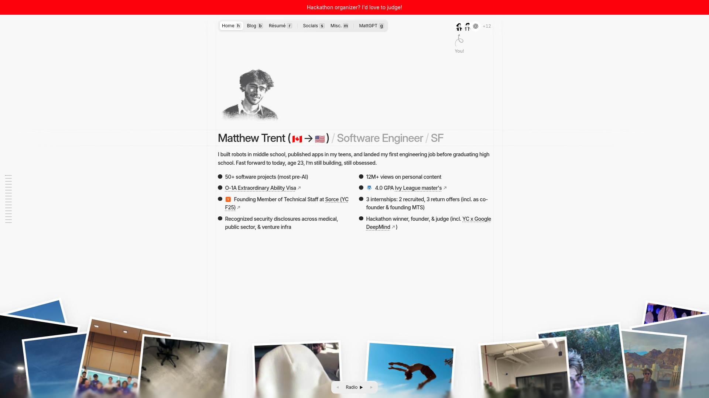

# DESIGN.md: Matthew Trent portfolio

## Source

- URL: <https://matthewtrent.me/?utm_source=chatgpt.com&s=lu8ca6Ja>
- Capture date: 2026-11-09 (Asia/Shanghai)
- Evidence: live HTML response, Firecrawl branding output, full-page screenshot, public route map, and first-party asset mirror.
- Local mirror: [`clones/matthewtrent.me`](../../clones/matthewtrent.me)
- Vendored assets: [`VENDORED_ASSETS.json`](../../clones/matthewtrent.me/VENDORED_ASSETS.json)
- Vendored runtime: [`RUNTIME_MANIFEST.json`](../../clones/matthewtrent.me/RUNTIME_MANIFEST.json)

## Reference Screenshot



The screenshot is a visual reference for the captured viewport. The page continues into long editorial sections and interactive galleries below the fold.

## Design Summary

This is a deliberately personal, low-chrome portfolio built as a SvelteKit application. Its visual language combines a pale paper canvas, a centered narrow document column, thin rules, browser-like glass controls, a red announcement strip, black text, and photographic objects that appear to rest on the page. The design uses small “physical” metaphors: a page curl, paper receipts, a photo pile, a sphere of childhood images, shelves of records, and live visitor marks.

The dominant interaction pattern is progressive disclosure. The first screen is readable without JavaScript, then hydration adds magnetized links, keyboard shortcuts, live-cursor presence, hover expansion, scroll-driven section state, drag/scroll galleries, sound toggles, and modal/drawer surfaces.

## Design Tokens

### Colors

| Role | Observed value | Notes |
| --- | --- | --- |
| Page background | `#f8f8f8` / `#ffffff` | Route-dependent theme color; the homepage uses a near-white paper field. |
| Ink | `#27272a` / `#0e0e0e` | Main text and controls. |
| Announcement red | `#fd010c` | Full-width top announcement strip and accent state. |
| Highlight grey | `#f0f0f0` | Inferred from the theme-palette CSS variables. |
| Glass fill | `color-mix(...)` white/grey | Frosted controls use translucent fill, inset highlight, `blur(22px)`, and saturation. |
| Rules | `#d8d8d8` to `#e8e8e8` | Thin structural lines and document boundaries. |

### Typography

- The scrape detector reports a Twemoji flag font because the page renders country flags inline; the practical text stack is `Inter`, `Inter Fallback`, system UI, Segoe UI, Roboto, Helvetica Neue, Arial, sans-serif.
- Body copy is compact, approximately `14px` with a comfortable desktop line height.
- Hero and section headings are large but not display-editorial; the captured branding pass reports approximately `30px` for `h1`/`h2`.
- Keyboard hints use native-looking `<kbd>` labels and small utility text.

### Spacing And Layout

- A centered document “sheet” is bounded by vertical rules and has a narrow desktop reading width; the hero screenshot shows the main content column surrounded by a large open canvas.
- Navigation is a compact horizontal app bar with `4px`-scale spacing and almost-square controls.
- Borders and radii are restrained: the branding pass reports a `2px` default radius and square primary controls.
- The bottom photo rail intentionally breaks the document boundary with absolute positioning, z-index layering, white photo borders, and small rotations.
- Mobile behavior collapses the app bar and keeps the paper metaphor while switching large horizontal media to touch-friendly horizontal gestures.

## Components And Effects

### Chrome and navigation

- `ed3__announce`: sticky/full-width announcement backing plus a red announcement strip.
- `ed3__appbar`: app bar with glass shell, route links, native `<kbd>` shortcut hints, menu/settings drawers, and SvelteKit hover prefetch (`data-sveltekit-preload-data="hover"`).
- `magnetic-hover`: cursor-proximity translation/“magnetic” hover effect for links and controls.
- `ed3-glass`: reusable glassmorphism primitive with `backdrop-filter: blur(22px) saturate(1.15)`, color-mixed fills, inset highlights, and soft shadow.
- `ed3-cursor-dock` and `data-live-cursor-layer`: canvas-backed live visitor cursor/presence layer with an accessible hidden fallback.

### Paper, scroll, and depth

- `page-curl`: CSS page-corner curl built from nested layers, pseudo-elements, shadows, and custom properties such as `--curl-grip` and `--curl-flap`.
- `scroll-edge-blur`: stacked blur layers with gradient masks create a frosted transition at the viewport edge.
- `roll` heading labels: section headings are wrapped so words can animate/reveal on scroll.
- `data-prediction-section` markers: semantic section IDs feed scroll analytics and navigation prediction.

### Media and galleries

- `sphere-media`: drag/tap/horizontal-scroll sphere gallery; the HTML exposes a semantic group label and a visually hidden list of image descriptions.
- `rcp` receipt section: form state drives a live receipt preview; CSS variables control paper roll, rules, ticket band cells, and physical printer imagery.
- `rgut` receipt gutter: edge-mounted receipt/photo slots use per-item rotation, sway duration, delay, aspect, and peek custom properties.
- `shelf`: 3D-ish record/playlist shelf with spine text, creases, paper layers, and hover expansion.
- `hover-expand`: generic image/card expansion behavior for galleries and proof surfaces.
- Bottom photo pile: absolutely positioned photos with white borders, transforms and controlled overlap; this reads as a physical collage rather than a CSS card grid.

### Interaction and data techniques

- SvelteKit SSR + hydration; route chunks and CSS are split under `/_app/immutable/` and preloaded from `<link rel="modulepreload">`.
- The mirror now includes the first-party `/_app/immutable/` entry/chunk graph and restores the inline SvelteKit bootstrap with analytics credentials disabled.
- Progressive enhancement: server HTML contains readable content and controls before client enhancement.
- Keyboard navigation: `h`, `b`, `r`, `s`, `m`, `g` are surfaced in the app bar and map to route/menu actions.
- Pointer/touch parity: controls expose `role`, `aria-label`, `tabindex`, touch hints, and keyboard alternatives.
- `prefers-reduced-motion` and iOS scroll-inset handling are present in the boot code; viewport-fit and safe-area behavior are explicit.
- Analytics/evolution tracking records route visits, scroll thresholds, section reach, link clicks, and browser/device metadata. The local mirror removes these scripts and `/api` calls.
- Sound is cookie-backed (`data-sound="on|off"`) and theme state is applied before hydration to avoid a flash of the wrong palette.

## Effect Terminology

| Observed term | Meaning in implementation terms |
| --- | --- |
| Glassmorphism | Frosted translucent surface using `backdrop-filter`, `color-mix`, inset highlights, and blur. |
| Magnetic hover | Pointer-distance based transform that makes a link/control follow the cursor slightly. |
| Live cursor / visitor presence | Canvas or DOM overlay showing other viewers and a local “You!” marker. |
| Page curl | Layered CSS corner-fold illusion with flap, crease, grip, sheen, and shadow. |
| Scroll-edge blur / frost | Stacked masked blur layers at the viewport edge to soften content entering/leaving view. |
| Tilted photo pile | Overlapping absolutely positioned media with rotation, z-index, white border, and gentle sway. |
| Progressive disclosure | Base SSR content first; galleries, menus, MattGPT, Spotify, and receipt interactions become active after hydration. |
| Drag-to-spin sphere | Pointer/touch drag changes a gallery's spherical projection or item ordering. |
| CSS variable choreography | Per-item custom properties drive rotation, sway, timing, aspect, and layout without duplicating CSS rules. |
| Native affordance styling | `<kbd>`, `<dialog>`, `<details>`, `role="tab"`, `aria-live`, and semantic groups are styled rather than replaced by canvas-only UI. |

## Page Patterns

1. Top announcement and app bar remain visually separate from the document sheet.
2. Identity hero uses a halftone portrait, name/role line, short paragraph, and two-column bullet metrics.
3. Project, experience, testimonial, music, childhood, and contact sections are long-form vertical modules marked with section headings and thin rules.
4. Interactive media is framed as a physical object: sphere, record shelf, receipt printer, paper ticket, or photograph.
5. Contact is a tabbed print/collect workflow with an editable form and a live receipt preview.
6. Blog routes reuse the same chrome but switch to denser article layout, TOC, related items, and share controls.

## Agent Build Instructions

- Treat the page as a document on a light canvas, not as a dashboard of cards.
- Keep a narrow centered content sheet and let selected media escape its edges.
- Use near-square controls, 1px rules, restrained radii, and one strong red announcement accent.
- Implement interactions as progressively enhanced HTML; keep labels and keyboard paths available without animation.
- Use CSS custom properties for per-item motion and a small number of reusable primitives (`glass`, `magnetic`, `photo-pile`, `receipt`, `sphere-gallery`).
- Respect reduced motion, touch input, safe-area insets, and focus-visible states.
- Do not copy personal text, portraits, logos, third-party playlist art, or analytics data into a new product without permission. The mirror is for technical inspection and local reference.

## Alignment Audit

After vendoring the externally referenced image set, the local mirror contains 115 image assets under `media/external/` plus the original first-party media. Image and poster references resolve locally; 5 video sources remain remote because they are large media files rather than still images. The static pages also retain normal outbound links to GitHub, LinkedIn, Discord, Spotify and referenced project sites.

The remaining behavioral differences are service-backed: live visitor cursors/presence, analytics/evolution events, Spotify playback and now-playing state, MattGPT responses, receipt submission, map/geo data, and any server-side form action. The SvelteKit UI runtime is vendored locally, so menus, tabs, keyboard shortcuts, CSS motion, galleries, and client-side presentation logic can run without the original JS host.

## Rerun Inputs

```yaml
workflow: firecrawl-website-design-clone
source_url: https://matthewtrent.me/?utm_source=chatgpt.com&s=lu8ca6Ja
target_stack: SvelteKit / HTML / CSS / JavaScript
output: docs/audit/MATTHEWTRENT_DESIGN.md
mirror_script: tools/mirror_matthewtrent.py
```
