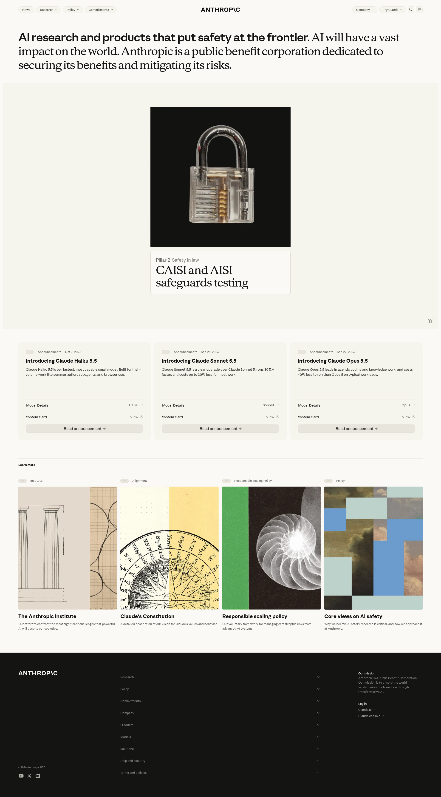

# AI Lab Home / Anthropic Homepage Reference

## Source

- Primary page: https://www.anthropic.com/
- Capture date: 2026-11-04
- Evidence: full-page screenshot, saved HTML, and Firecrawl branding extraction captured for this task.
- Local evidence: [full-page capture](references/anthropic-home-fullpage.png); the raw capture and branding JSON remain at `D:\tools\anthropic-home-live.html` and `D:\tools\anthropic-home-branding.json` on the development machine.

Treat the capture as the reference for hierarchy, section order, spacing, and content density. This implementation uses 1byteone copy, navigation, and article data. It does not reproduce the Anthropic wordmark or site copy.

## Observed Design System

The page uses a warm, near-white canvas (`#FAF9F5`), nearly black typography (`#141413`), pale neutral control and card surfaces (`#F5F4ED`), subtle borders (`#E8E6DC`), and a restrained terracotta link accent (`#D97757`). Firecrawl identifies Anthropic Sans for body text and Anthropic Serif for headings; the implementation uses local system sans/serif stacks so the page remains usable without remote fonts.

The header is a single horizontal row: pill navigation on the left, a wordmark centered on wide screens (moving to the left at intermediate widths), and company/action/search/menu controls on the right. The opening statement spans nearly the full content width and mixes a bold sans-serif lead with a large editorial serif continuation. A pale, full-width feature stage follows. It begins with one large square image (about 610px at a 1920px viewport), expands into an irregular field of image tiles, then leaves an open center for a large headline and CTA while tiles remain around the edges. A small pause control sits at the lower-right edge. The source main feature is a Canvas animation rather than a video element. Three equal announcement cards follow without a separate section headline, then a thin-rule Learn More label and four portrait image cards with their small topic labels above the images. A dark three-column footer closes the page with a left identity block, stacked disclosure rows, and a right mission statement.

The source uses sparse rules, rounded navigation pills, softly rounded announcement cards, portrait image crops, generous whitespace, and a dark footer. It does not use glass panels, gradients, or decorative background effects.

## Page Pattern

1. Rounded global navigation and identity that shifts position with viewport width.
2. A large mixed-type statement with no additional hero paragraph.
3. One full-width editorial feature stage that grows from a centered square Canvas image into a tile wall, then reveals centered HTML copy while the tiles settle around the edges; the pause control stays at lower right.
4. Three-column announcements with a compact label/date row, short copy, categorized metadata, and a full-width action.
5. A thin-rule `Learn more` label followed by four topic labels, portrait images, titles, and concise descriptions.
6. A compact expandable archive entry point for the additional AI Lab filtering tools.
7. Dark footer with Products, Models, Solutions, Help and security, Terms and policies, site index disclosures, and a concise mission panel.

At tablet widths, three-column cards reduce to two columns and the centered wordmark remains visible while navigation collapses. At phone widths, controls stay compact, cards stack vertically, the portrait gallery uses two columns, and footer sections stack. AI Lab profile, project, contact, and legal routes share this module shell so internal navigation does not fall into another site theme.

## Interaction Contract

- The source homepage feature is a Canvas animation with HTML copy and a pause control. The captured page contains no hero `<video>` element, so embedding an unrelated official video would not match the reference.
- The local hero uses a 4×3 hero atlas for its seed image and all 120 cells from the 12×10 tile atlas. Scroll progress reveals tiles from the center outward, holds the assembled wall, then moves the tiles toward the edges to clear space for the selected AI engineering records.
- The pause control freezes the current scroll-linked frame and resumes from the current page position. Rendering stops when the stage leaves the viewport or the tab is hidden. Reduced-motion preference renders a stable mosaic. The canvas is decorative; story links remain keyboard-accessible HTML.
- The centered 1BYTEONE wordmark uses a staggered letter reveal and tightens slightly while the sticky header remains visible during scroll. Navigation disclosures close on outside click or Escape; search opens as a modal and supports `/` and `Ctrl/Cmd+K`.
- The original page exposes no public tile-position manifest or animation source in the captured assets. This is an evidence-based recreation of the observed stages using the locally captured atlases, not a claim to reproduce Anthropic's private tile coordinates or source code.
- Search deep links open the archive disclosure before focusing the search field.
- Header language and color-mode controls remain keyboard accessible.
- All research, track, and announcement cards link to local AI Lab routes.
- Footer disclosures use native `details` and `summary` elements.

## Asset Handling

The local reference images were downloaded from the homepage capture with the user's explicit instruction to reuse them in this project. That instruction does not independently establish license or redistribution terms. Each identifiable image has a source URL and SHA-256 hash in `assets/data/ai-lab-anthropic-home-assets.json`; the locally prepared artwork sprite is marked with its unresolved direct asset URL instead of an inferred one.

## Implementation Scope

The standalone Hugo list template at `layouts/ai-lab/list.html` owns the AI Lab homepage shell. Shared article and category routes continue using their existing templates and styles. Homepage-specific overrides use the `.ai-lab-home-page`, `.al-ref-*`, and `.al-home-*` scopes in `static/css/ai-lab.css`.
