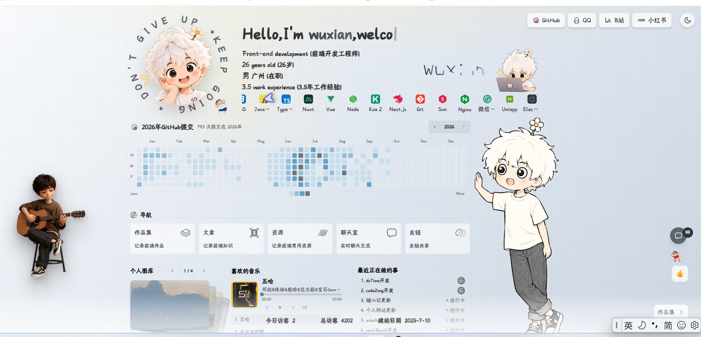

# DESIGN.md: alxian.cn

## Source

- URL: https://alxian.cn/
- Capture date: 2026-10-10
- Evidence: live DOM inspection, CSS extraction, browser screenshot and source asset inventory.

## Reference Screenshot

## Design Summary

The page is a one-screen personal dashboard rather than a conventional portfolio. It uses a pale blue-gray paper canvas, a subtle 20px grid, translucent white controls, hand-drawn character art and dense utility widgets. The visual hierarchy is built from a 1152px desktop frame: profile/skills at the top, GitHub activity in the middle, five navigation tiles below, then gallery, music and work-in-progress panels.

## Design Tokens

### Colors

- Canvas: `#f8fafc` to `#cbd5e1`, with a blue-gray center `#e2e8f0`.
- Text: `#333` in light mode; `#e2e8f0` on dark `#111315`.
- Accent: pale yellow `#ffe28a` and cyan `#4e96ba`.
- Glass surfaces: `rgba(255,255,255,.70)` with `rgba(0,0,0,.10)` borders.
- Comment control: `#5d676b`, hover `#2c363f`.

### Typography

- Primary: a rounded handwritten display face when available, falling back to Microsoft YaHei, Arial and sans-serif.
- Utility text: Consolas/Microsoft YaHei monospace.
- Hero title: approximately 40px, heavy weight; body metadata: 16px/27px; labels: 11-14px.

### Spacing And Layout

- Desktop frame: `max-width: 1152px`, centered with 20px horizontal padding.
- Top profile row: roughly 240px tall; profile art column 250px, information column 768px.
- Main split: 840px content plus 224px character art.
- Navigation cards: five equal tiles, approximately 156px by 73px.
- Cards use 8-10px radius, soft borders, transparent white fills and light blur.

## Components

- Loading curtain with floating character, KEEP GOING / DON'T GIVE UP copy, grain and progress bar.
- Fixed social buttons, theme toggle and custom cursor.
- Draggable guitar character with note burst animation.
- Profile hero, animated typing name and horizontally looping skills.
- GitHub contribution heatmap with year controls.
- Five navigation tiles: works, blog, resources, chat and friends.
- Gallery carousel, music player, recent work checklist and traffic statistics.
- Fixed right character, comment counter and reaction tray.

## Page Patterns

The desktop composition is intentionally dense and fills the viewport. At widths below 720px, decorative guitar/person art is hidden, the layout becomes a vertical scroll, skills remain horizontally clipped, and controls retain 44px-class touch targets. Dark mode persists in local storage and follows the system preference by default.

## Agent Build Instructions

Implement this as an isolated Hugo site theme. Keep all personal content and images outside the theme contract; use a theme-specific CSS/JS pair and a registered `alxian` preview path. Use `relURL` for every static asset so `/themes/alxian/` works on GitHub Pages. The production Oil page must not inherit any alxian global selectors. The static chat, comment, reaction, friend-link application and visitor counters are explicit client-side fallbacks until an external API is connected.

## Rerun Inputs

workflow: firecrawl-website-design-clone
source_url: https://alxian.cn/
target_stack: Hugo static site
output: docs/design/ALXIAN_DESIGN.md
